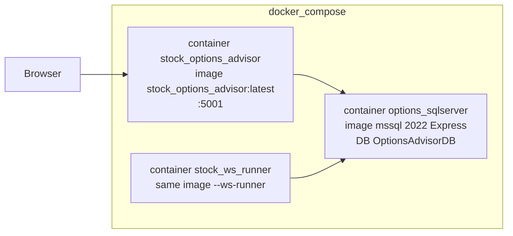
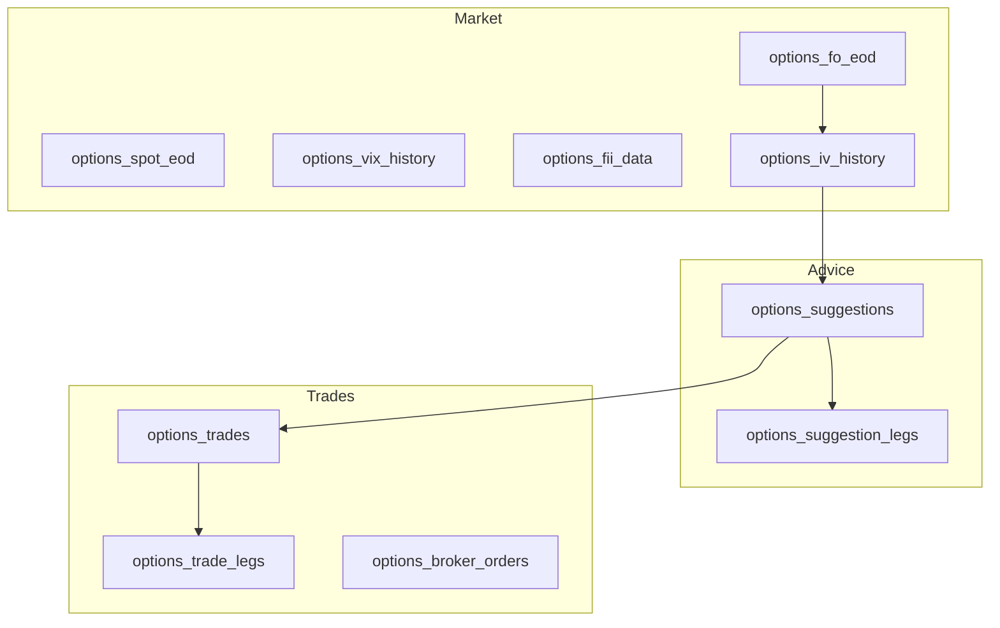
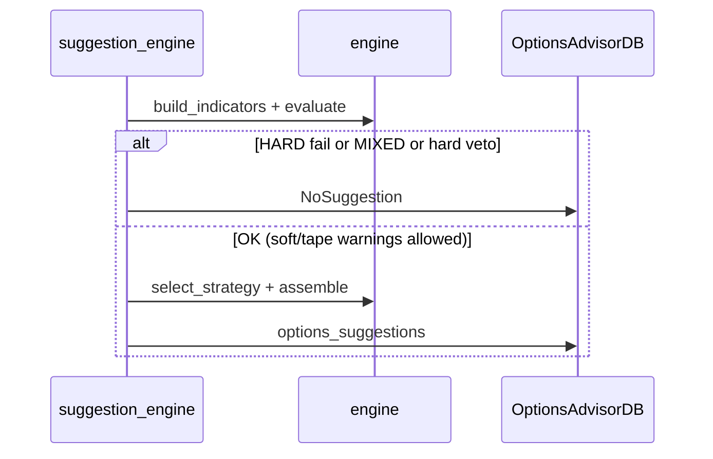
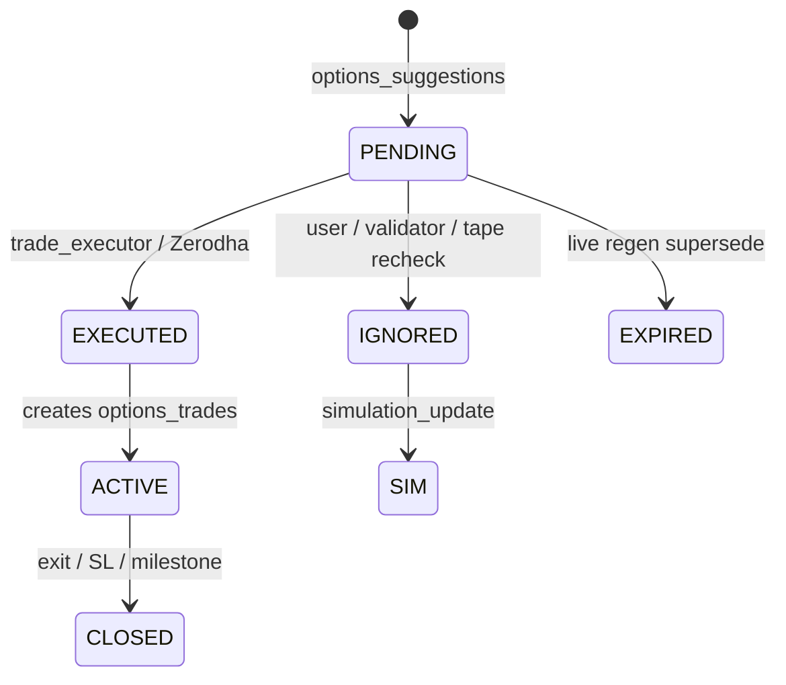
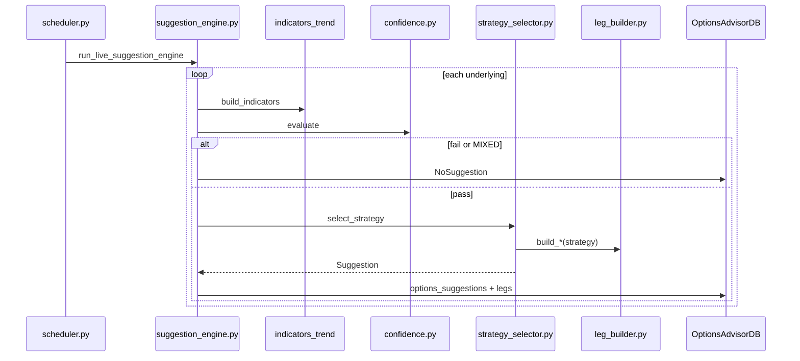
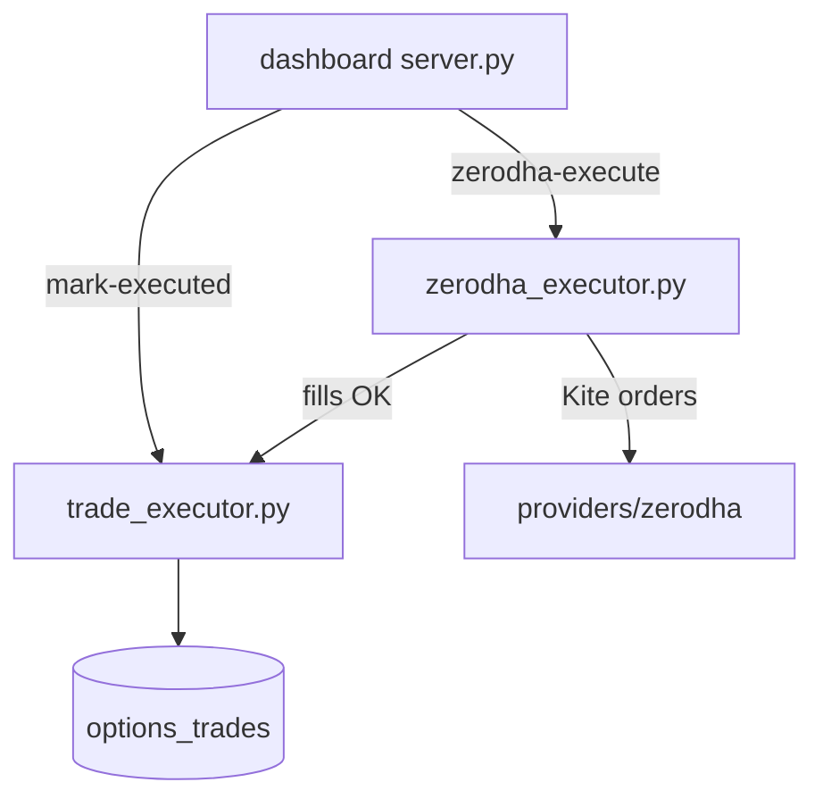
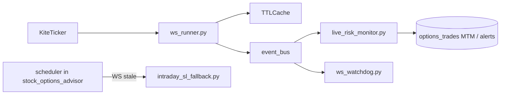

# Options Advisor - Complete Guide

**Last updated:** 2026-11-22

**Single document** for install, day-to-day ops, and architecture.  
Do not recreate `readmefirst.txt`, handbooks, or separate OPERATIONS/SETUP markdown files.


| How to navigate    | Tip                                                                   |
| ------------------ | --------------------------------------------------------------------- |
| **Jump index**     | Click a link below                                                    |
| **Editor Outline** | Auto TOC from headings                                                |
| **Diagrams**       | ASCII always visible; Mermaid needs Markdown Preview (`Ctrl+Shift+V`) |


---

## Jump index

### Part A - Install and operate

- [A1. Landscape](#a1-landscape)
- [A2. Prerequisites](#a2-prerequisites)
- [A3. Bootstrap](#a3-bootstrap)
- [A4. Script catalog](#a4-script-catalog)
- [A5. Clock and jobs](#a5-clock-and-jobs)
- [A6. Secrets](#a6-secrets)
- [A7. Code deploy](#a7-code-deploy)
- [A8. Backup and archive](#a8-backup-and-archive)
- [A9. Troubleshooting](#a9-troubleshooting)


### Part B - Architecture

- [B1. Layers and boundaries](#b1-layers-and-boundaries)
- [B2. Runtime and Docker](#b2-runtime-and-docker)
- [B3. Contracts and exceptions](#b3-contracts-and-exceptions)
- [B4. Configuration](#b4-configuration)
- [B5. Database](#b5-database)
- [B6. Module map](#b6-module-map)
- [B7. Suggestion pipeline](#b7-suggestion-pipeline)
- [B8. Trade lifecycle](#b8-trade-lifecycle)
- [B9. Providers and live](#b9-providers-and-live)
- [B10. Dashboard and alerts](#b10-dashboard-and-alerts)
- [B11. Simulation and scripts](#b11-simulation-and-scripts)
- [B12. Code flows](#b12-code-flows)
- [B13. Change playbooks](#b13-change-playbooks)

---


# Part A - Install and operate


## A1. Landscape

```
                         +---------------------------+
                         | Azure Automation          |
                         | VM start 08:55 / stop 15:45|
                         | Mon-Fri IST               |
                         +-------------+-------------+
                                       |
 +------------------+                  v
 | Windows laptop   |     SSH      +----------------------------------+
 | OptionsAdvisorDB | <----------> | Azure VM                         |
 | _Archive (SQL    |  archive     | container options_sqlserver       |
 | Express)         |  pull 09:15  |   image mssql 2022 Express       |
 | Task Scheduler   |              |   DB OptionsAdvisorDB            |
 +------------------+              | stock_options_advisor :5001      |
                                   | stock_ws_runner (Zerodha ticks)  |
                                   | options_caddy :443 (HTTPS)       |
                                   +----------------------------------+
                                              ^
                                              | browser
                                     https://<VmHost>/
```


| Piece          | Where                                           | Role                               |
| -------------- | ----------------------------------------------- | ---------------------------------- |
| Dashboard      | `https://<VmHost>/` (Caddy → :5001 localhost)   | UI, jobs, config                   |
| Hot DB         | Container `options_sqlserver` / `OptionsAdvisorDB` | Live operational data              |
| Archive DB     | Laptop `OptionsAdvisorDB_Archive`               | Cumulative history                 |
| Manual forever | You                                             | Zerodha login each trading morning |


**Isolation:** never import from / write to equity `stock_analyzer_system` / `StockAnalyzerDB`. Tables here are all `options_`*.

---


## A2. Prerequisites

- [ ] Git, Python 3, Azure CLI, OpenSSH on laptop
- [ ] SQL Server Express + SSMS/sqlcmd on laptop
- [ ] Azure Ubuntu 22.04 VM, `.pem` key, public IP
  - Preferred: size **Standard_B2s**, OS disk **Standard SSD** (~32 GB), not Premium SSD
  - `setup-new-environment.ps1` converts Premium → Standard SSD automatically if needed
- [ ] Repo cloned
- [ ] Secrets: DB password, Zerodha API key/secret, `OPT_BOOTSTRAP_ADMIN_LOGIN` / `OPT_BOOTSTRAP_ADMIN_PASSWORD` (first admin), optional `OPT_DASHBOARD_SESSION_SECRET`
- [ ] Optional: `OptionsAdvisorDB-*.bak` to restore

---


## A3. Bootstrap

Ask Cursor: *"Follow README.md and bootstrap"*. Agents execute in order:


| Step | Action                                                                                                                                                   |
| ---- | -------------------------------------------------------------------------------------------------------------------------------------------------------- |
| 1    | Copy `deploy/azure/laptop.config.ps1.example` -> `laptop.config.ps1`; fill `VmHost`, `SshKeyPath`, Azure RG/VM, `LocalSqlServer`, and `TailscaleAuthKey` (reusable auth key from the Tailscale admin console; never commit) |
| 2    | Copy `.env.docker.example` -> `.env.docker`; fill `MSSQL_SA_PASSWORD`, `OPT_DB_PASSWORD` (same), Zerodha keys, `OPT_BOOTSTRAP_ADMIN_LOGIN` / `OPT_BOOTSTRAP_ADMIN_PASSWORD` (seeds first admin). Optional `OPT_DASHBOARD_SESSION_SECRET`. **Never commit** |
| 3    | `az login` if needed                                                                                                                                     |
| 4    | `.\deploy\azure\setup-new-environment.ps1` (or `-RestoreFromBackup "PATH\to.bak"`; or `setup-laptop.ps1` only) — self-signed HTTPS, joins laptop + VM to Tailscale, then closes public inbound 22/80/443/5001 |
| 5    | `python scripts/validate_setup_sync.py` then `.\deploy\azure\Test-EnvironmentSetup.ps1` until exit 0                                                     |
| 6    | On VM: `git pull` + `chmod +x deploy/*.sh ...` + `./deploy/vm-restart.sh`                                                                                |
| 7    | Report: `https://<VmHost>/` is the Tailscale address (accept cert warning once). Sign in at `/dashboard-login` with the bootstrap admin. Open **Users** (admin) to create traders. Each user clicks Zerodha Login for their own Kite token. Feed/ticks use the **admin** Zerodha session. Set the Zerodha redirect to `https://<tailscale-name>.ts.net/zerodha/callback` |


**First boot (empty database).** Container start (and `main.py --init-db` / `deploy/db-setup.sh`) runs `database/schema.py` `create_all_tables()` — the only DDL. Tables, column migrations, and indexes live in that file. Indexes use `CREATE INDEX IF NOT EXISTS` (translated to a `sys.indexes` guard): **created once on first install or when a new index is added in code; later boots do not rebuild them.** Then seeds only:

- `options_runtime_flags` defaults (missing keys only; `trade_execution_enabled` starts off; later edits are kept)
- one `app_users` admin when that table is empty, from `OPT_BOOTSTRAP_ADMIN_*` (changing the env later does not reset the password)
- the admin `zerodha_sessions` row from `data/zerodha_session.json` only when that admin row is empty
- `options_events_calendar` from `EVENTS_CONFIG` (plus Trading Economics when `OPT_TE_API_KEY` is set)

No suggestions, trades, or demo cards are inserted. Lot size uses `config.py` `default_lot_sizes` until `options_lot_sizes` is filled by chain ingest or `scripts/migrate_nse_lot_sizes.py`. `seed_today_suggestions.py`, `seed_test_data.py`, and `scripts/seed_*.py` are optional practice scripts. Do not run them as part of install.

**VM-only alternative:** `.\deploy\azure\remote-vm-install.ps1`, or SSH + clone + `.env.docker` + `./deploy/vm-install-deploy.sh`.

---


## A4. Script catalog


| Script                                                                            | Purpose                             |
| --------------------------------------------------------------------------------- | ----------------------------------- |
| `deploy/azure/setup-new-environment.ps1`                                          | Greenfield laptop + VM + uptime (+ Standard SSD OS disk) |
| `deploy/azure/setup-laptop.ps1`                                                   | Laptop folders + archive task       |
| `deploy/azure/Test-EnvironmentSetup.ps1`                                          | Verification checklist              |
| `deploy/azure/remote-vm-install.ps1`                                              | VM Docker + app + HTTPS, then Tailscale lockdown |
| `deploy/azure/open-port-5001.ps1`                                                 | NSG :5001 (HTTP dashboard)          |
| `deploy/azure/open-port-https.ps1` / `enable-https.sh` / `enable-https-remote.ps1` | Self-signed HTTPS. Does not open public 80/443 |
| `deploy/azure/enable-tailscale.ps1` / `install-tailscale.sh` / `close-public-inbound.ps1` | Join Tailscale, then delete public inbound 22/80/443/5001 |
| `deploy/azure/close-port-5001.ps1`                                                | Remove public NSG :5001 (also done by the Tailscale lockdown) |
| `deploy/azure/VMUpTimeConfiguration.ps1`                                          | Azure start/stop schedules          |
| `deploy/azure/backup-database-to-laptop.ps1` / `restore-database-from-laptop.ps1` | Hot DB move                         |
| `deploy/azure/pull-archive-and-merge.ps1` / `register-laptop-archive-task.ps1`    | Archive pull + ACK (retries every 15m until ACK or ~15:45) |
| `deploy/vm-restart.sh` / `deploy/update.sh`                                       | Rebuild/restart app                 |
| `deploy/install-boot-service.sh` / `options-advisor.service` / `boot-stack.sh`   | systemd: `docker compose up -d` after reboot (loads `.env.docker`) |
| `deploy/backup.sh` / `deploy/restore.sh` / `deploy/archive-export.sh`             | VM backup helpers                   |
| `deploy/archive-truncate-vm.sh`                                                   | VM ACK truncate after laptop merge  |
| `scripts/validate_setup_sync.py`                                                  | Repo setup sync check               |
| `scripts/merge_archive_into_local.py`                                             | Merge archive `.bak` into laptop DB |
| `scripts/migrate_nse_lot_sizes.py`                                                | NSE lot revision → DB + closed P&L  |
| `seed_today_suggestions.py`, `seed_test_data.py`, `scripts/seed_*.py`             | Optional practice suggestions. Not part of first install |


---


## A5. Clock and jobs

**One place for wall-clock times** (IST, `Asia/Kolkata`). Job *logic* is in Part B; *when* they fire is here.

```
 Mon-Fri (VM up 08:55-15:45)
 08:55  Azure starts VM
 09:00  morning_eod_catchup  (+ events_seed on Monday)
 09:05  event_eve_review (eve-of HIGH event → PRE_EVENT_EXIT for ACTIVE shorts)
 09:15  Laptop archive task (retry every 15m until ACK or ~15:45; needs readable VM ``*-latest.bak``)
 09:30  Fri: weekly_archive
 09:35  Fri: weekly_log_cleanup | daily: intraday_validator
  10:00–14:00 hourly     live_suggestion_engine
 15:35  intraday_close_snapshot
 15:36  Fri: archive_export
 15:38  Fri: db_backup
 15:45  Azure stops VM

 Every ~3m during session: intraday_sl_fallback
 Every ~5m during session: pcr_regen_poll
 Every ~5m during session: zerodha_capital_snapshot per logged-in trader (persist that user's idle/utilised on change)
```


| Setting                     | Default                                             |
| --------------------------- | --------------------------------------------------- |
| Log delete keep             | 7 days (`delete_keep_days`)                         |
| Hot historical archive keep | 365 days (`hot_archive_keep_days`)                  |
| VM power script             | `VMUpTimeConfiguration.ps1` (08:55 IST = 03:25 UTC) |


**EOD chain order** inside `morning_eod_catchup` (evening `eod_nightly_pipeline` and solo EOD crons are **off** by default):

`fo_bhav_download` -> `spot_bhav_download` -> `vix_download` -> `fii_download` -> `iv_calculation` -> (`suggestion_engine` **skipped** by default) -> `drift_verifier` -> `simulation_update` -> `exit_engine` -> `trade_greeks_update`

Live cards come from `live_suggestion_engine`, not the skipped EOD suggestion step.

Enable flags / handlers live in `SCHEDULER_CONFIG["jobs"]` and `JOB_FUNCS` in `scheduler/scheduler.py` (not duplicated as a second schedule here).


| Job name                                                                 | Typical         | Notes                         |
| ------------------------------------------------------------------------ | --------------- | ----------------------------- |
| `morning_eod_catchup`                                                    | On @ 09:00      | Runs EOD chain                |
| `live_suggestion_engine`                                                 | On multi-window | Live cards                    |
| `intraday_validator`                                                     | On @ 09:35      | Reprice PENDING               |
| `intraday_close_snapshot`                                                | On @ 15:35      | LTP capture                   |
| `intraday_sl_fallback`                                                   | On every 3m     | If WS stale                   |
| `pcr_regen_poll`                                                         | On every 5m     | Regen hints                   |
| `zerodha_capital_snapshot`                                               | On every 5m     | Per logged-in trader: store that user's idle/utilised when margins change (History → Capital) |
| `event_eve_review` / `events_seed`                                       | On @ 09:05 / Mon | Eve-of HIGH + seed           |
| `weekly_archive` / `weekly_log_cleanup` / `archive_export` / `db_backup` | Fri             | Archive path                  |
| Solo `fo_bhav_*` … `suggestion_engine`                                   | Usually off     | Available for manual Jobs tab |
| `weekly_cleanup`                                                         | Blocked         | Legacy                        |


---


## A6. Secrets


| File                             | Purpose                                  | Commit? |
| -------------------------------- | ---------------------------------------- | ------- |
| `deploy/azure/laptop.config.ps1` | VM IP, SSH key, Azure RG, local SQL      | **No**  |
| `.env.docker`                    | DB passwords, Zerodha, bootstrap admin login/password, session secret | **No**  |
| `data/zerodha_session.json`      | Admin feed Kite token (mirrored from admin `zerodha_sessions`) | **No**  |
| `*.example` templates            | Starters                                 | Yes     |

**Multi-user:** First boot creates the `app_users` admin from `OPT_BOOTSTRAP_ADMIN_*` (empty DB only). New trades/orders/alerts get `owner_user_id` from the signed-in user at execute time — no legacy trade backfill. History tabs (Trades, Charts, Performance, Capital, reversals) and capital snapshots are scoped to the signed-in user; Suggestions History overlays that user's execute/ignore state and only links their trades. Admin: Config, Users, Logs/Jobs/WS. Each trader logs into Zerodha separately. Place, close, supplement, suggestion/execute available-margin checks, margin refresh/quotes, capital snapshots, and the avatar “Your Zerodha” line use **only that user’s** `zerodha_sessions` row (their Kite api_key + token) — never the admin feed token. Stored Final/Peak is re-checked against that user’s live available margin before showing funds OK. Ticks still use the admin session. **Per-trader Kite apps:** a personal API key is bound to one Zerodha client id (stored on `zerodha_sessions.api_key` / `api_secret`; logout clears the token only). Each user edits name / password / Kite key+secret on **Account settings** (avatar menu); admins can also set another user’s Kite app or password from the Users tab. API key and secret are write-only — APIs and UI never return or display them after save (status only: configured / not set). Admin may keep `OPT_ZERODHA_API_KEY` / `SECRET` as feed bootstrap; traders never fall back to the admin key. A trade with no `owner_user_id`, or a different signed-in user, cannot send Kite orders. Avatar **Zerodha logout:** admin clears SQL + session file and parks ticks for everyone; a trader clears only their own `zerodha_sessions` row. Avatar **Sign out** clears only the app cookie — admin Zerodha / ticks stay on for other users. WS Monitor → **Disconnect tick feed** is the same full stop as admin Zerodha logout. Header **Feed** chip and avatar **Feed** line show shared tick mode for everyone: **Live**, **Market off**, **Connecting**, **Offline**. Admin Zerodha login/logout bumps a feed signal and `/api/tick-feed/stream` SSE pushes header + avatar + toast to open sessions within ~0.5s (no refresh). `/api/zerodha/status` still includes `tick_feed`; Suggestions and My Trades show one panel-top **LIVE TICKS ARE OFF** banner when Offline in session (not repeated on every trade card); Place/Close still confirm.


Trading knobs: `config.py` + DB `options_config` (Part B4).

---


## A7. Code deploy

Keeps DB and trades. **Always** preserve Zerodha session. Prefer `./deploy/update.sh` (loads `COMPOSE_PROFILES` from `.env.docker`, including `https`).

```bash
cd ~/options_advisor_system
cp -a data/zerodha_session.json /tmp/zerodha_session.json.bak 2>/dev/null || true
./deploy/update.sh
cp -a /tmp/zerodha_session.json.bak data/zerodha_session.json 2>/dev/null || true
docker compose ps && git log -1 --oneline
```


| Do                              | Don't                                                    |
| ------------------------------- | -------------------------------------------------------- |
| `git pull` + build + `up -d`    | `--fresh-db` / wipe `sqlserver_data` for routine deploys |
| Keep SQL volume                 | Restore unless you intend to replace data                |
| Preserve `zerodha_session.json` | `git reset --hard` over a live session                   |


Dashboard: `https://<VmHost>/` (self-signed). `VmHost` is the VM's Tailscale address after setup. Public inbound 22, 80, 443, and 5001 are closed. The Azure public IP stays so the VM can still call Zerodha.

### HTTPS and who can connect

**Default for new installs:** self-signed HTTPS, then `enable-tailscale.ps1` joins this laptop and the VM with `TailscaleAuthKey` and deletes the public inbound rules. Flask stays on `127.0.0.1:5001`; Caddy is reached through the tailnet. Install the Tailscale app on the phone and sign in to the same account.

**Existing VM (one command from the laptop, public SSH still open):**
```powershell
az login   # if needed
.\deploy\azure\enable-tailscale.ps1
```
Then open `https://<VmHost>/` → Advanced → Proceed (one-time warning). In the Zerodha app, set the redirect to the Tailscale name, for example `https://options-advisor.<tailnet>.ts.net/zerodha/callback`. Zerodha's form rejects the `100.x` address.

Do not run `open-port-https.ps1` afterward. A later install sees `data/tailscale_lockdown` on the VM and does not reopen 80/443.

---


## A8. Backup and archive

```
 OptionsAdvisorDB (VM hot)
    | weekly_archive -> *_Archive tables
    | archive_export -> .bak + PENDING.json
    | db_backup      -> OptionsAdvisorDB-latest.bak
    v
 Laptop pull/merge -> OptionsAdvisorDB_Archive
    v
 SSH ACK -> VM truncates exported archive + deletes PENDING (when safe)
```

**Never archive:** `options_config`, `options_runtime_flags`, `options_lot_sizes`, `options_expiry_calendar`, `options_events_calendar`, `options_trade_mtm_snapshot`, `app_users`, `zerodha_sessions`, `options_suggestion_user_state`.  
**Delete-only logs:** `options_system_logs`, `options_job_log`, `options_zerodha_execution_jobs`, `options_notifications`.

Archive jobs run **inside** the app (pyodbc); export uses temp DB `OptionsAdvisorDB_ArchiveExport`, then `.bak` under `./backups` (SQL bind-mount). Friday clock times: [A5](#a5-clock-and-jobs).


| Action                      | Command                                                          |
| --------------------------- | ---------------------------------------------------------------- |
| Register laptop task (once) | `.\deploy\azure\register-laptop-archive-task.ps1`                |
| Manual archive pull         | `.\deploy\azure\pull-archive-and-merge.ps1`                      |
| Hot DB to laptop            | `.\deploy\azure\backup-database-to-laptop.ps1`                   |
| Restore hot to VM           | `.\deploy\azure\restore-database-from-laptop.ps1 -BakPath "..."` |
| On-VM backup/restore        | `./deploy/backup.sh` / `./deploy/restore.sh backups/...bak`      |


ACK refuses if `LAST_HOT_BACKUP.json` is missing or older than this export, `PENDING.json` is missing while `*_Archive` still has rows, or `*_Archive` row counts changed since export.

---


## A9. Troubleshooting


| Symptom               | Check                                                                 |
| --------------------- | --------------------------------------------------------------------- |
| Setup drift           | `python scripts/validate_setup_sync.py` + `Test-EnvironmentSetup.ps1` |
| SSH fails             | VM up? This laptop on the same Tailscale account? `VmHost` is the 100.x address + `.pem` in `laptop.config.ps1`. After a reboot wait ~2–3 min for Tailscale; if still dead: `az vm run-command` or temporary NSG :22 (close after) |
| Dashboard down        | Tailscale connected? Uptime schedule, `systemctl status options-advisor`, `docker compose ps` over SSH. On boot, `options-advisor.service` runs `deploy/boot-stack.sh` (needs `.env.docker`). Install once: `sudo ./deploy/install-boot-service.sh` |
| Stuck after VM reboot | `sudo systemctl enable --now docker tailscaled options-advisor`; then `curl -s -o /dev/null -w '%{http_code}\n' http://127.0.0.1:5001/health` |
| HTTPS / cert fail     | `docker logs options_caddy`; cert includes the Tailscale IP; see A7   |
| Archive stuck         | Laptop task; VM `git pull` + `vm-restart`; ACK conditions above. If merge fails with `\var\opt\mssql\...` paths, update `scripts/merge_archive_into_local.py` (RESTORE must WITH MOVE to local SQL data dir) |
| Zerodha execute fails | App login + that user's Zerodha session; `trade_execution_enabled` flag |
| Live P&L looks frozen | UI always prefers a **priced live/snap** MTM (leg LTPs present); only then falls back to DB `last_mtm`. Net on the card chip, Live Profit Levels, and the close preview share one fill-based charge (`estChargesFromLegs`) |


---


# Part B - Architecture


## B1. Layers and boundaries

```
  dashboard / alerts          scheduler
         |                        |
         v                        v
      database  <---------  lifecycle  -------->  providers (Zerodha)
                                 |
                                 v
                              engine (pure)
                                 |
                    contracts.py + config.py
```


| Module         | May do                       | Must not                                 |
| -------------- | ---------------------------- | ---------------------------------------- |
| `config.py`    | Values                       | Business logic                           |
| `contracts.py` | Dataclasses                  | I/O / DB                                 |
| `downloader/`  | Fetch + parse                | DB writes / strategy                     |
| `database/`    | SQL only                     | Decisions                                |
| `engine/`      | Pure math / gates / strategy | Import DB, downloader, dashboard, alerts |
| `lifecycle/`   | Orchestrate                  | Own long-lived UI                        |
| `scheduler/`   | Wire jobs                    | Heavy business logic                     |
| `dashboard/`   | Read DB + UI                 | Call engine to pick strategies           |
| `simulation/`  | Shadow ignored cards         | Mutate live trades                       |


Standards: no magic numbers outside `config.py`; explicit DB commit/rollback/close; log to `options_system_logs`; jobs write `options_job_log` + notify; exceptions `RecoverableError` / `JobFailure` / `CriticalError`; `StrategyVeto` = intentional sit-out.

---


## B2. Runtime and Docker

`main.py` modes: default (scheduler + dashboard), `--dashboard-only`, `--scheduler-only`, `--ws-runner`, `--init-db`, `--check-db`, `--zerodha-login` / `--zerodha-logout`, `--provider-status`, `--backfill-index-spot`.



Compose service names: `sqlserver`, `options_advisor`, `ws_runner` (profile `bundled` starts SQL).  
Env: `.env.docker` -> `OPT_DB_*`, `OPT_PROVIDERS`, Zerodha keys, `OPT_DASHBOARD_PORT`, `OPT_BOOTSTRAP_ADMIN_*`, optional `OPT_DASHBOARD_SESSION_SECRET`.  
Volumes: `sqlserver_data`, `./backups`, `./data`, `./logs`, `./archive`.  
Code deploy: [A7](#a7-code-deploy).

---


## B3. Contracts and exceptions

[contracts.py](contracts.py): shared dataclasses only (`MarketIndicators`, `Suggestion`, `NoSuggestion`, bhav rows, …).

[exceptions.py](exceptions.py):


| Type               | Meaning                                 |
| ------------------ | --------------------------------------- |
| `RecoverableError` | Retry / continue                        |
| `JobFailure`       | Job FAILED in `options_job_log`         |
| `CriticalError`    | Infra                                   |
| `StrategyVeto`     | Sit-out -> `NoSuggestion` (not a crash) |


---


## B4. Configuration

```
 config.py defaults  +  .env (infra)  +  options_config (UI)
                              |
                              v
              database.config_overlay -> live STRATEGY_CONFIG
```

Nested JSON overlays: **file default as base**, DB keys win, missing keys filled from file (so old saved blobs cannot hide new knobs).

Major dicts: `DATABASE_CONFIG`, `SCHEDULER_CONFIG`, `STRATEGY_CONFIG`, charges, `DASHBOARD_CONFIG`, `ALERTS_CONFIG`, `RETENTION_CONFIG`, …  
Runtime kill-switches: `options_runtime_flags`.

**Index lot sizes (Jan 2026+ NSE revision):** `options_lot_sizes` wins over `STRATEGY_CONFIG.default_lot_sizes` — NIFTY **65**, BANKNIFTY **30**, FINNIFTY **60**. After a revision, re-stamp legs / recalc closed P&L with `scripts/migrate_nse_lot_sizes.py` (close path uses stamped `lot_size`, not live Zerodha qty).

Trend knobs (high traffic): `trend_sma_*`, `trend_adx_min`, `trend_return_*`, `trend_session_*`. Opposing SMA vs tape -> `MIXED` sit-out; chop SMA is **not** lifted to BEARISH by a 5-10 day dump alone. Live directional picks still prefer **today's** open-vs-spot (`directional_require_today_tape`) and nearby OI walls (`oi_wall_block_em_fraction` × 1-day EM), but a mismatch is an **advisory warning on the card** — the suggestion is still shown (no direction flip). Soft confidence misses (DTE, news/events, PCR, FII, …) also keep the card; only a **HARD** ATM-liquidity fail hides it.

---


## B5. Database


| Item        | Value                                                                     |
| ----------- | ------------------------------------------------------------------------- |
| Name        | `OptionsAdvisorDB`                                                        |
| Prefix      | `options_`                                                                |
| DDL         | [database/schema.py](database/schema.py) + `list_tables()`              |
| Archive map | [database/archive_registry.py](database/archive_registry.py)            |
| Access      | [database/connection.py](database/connection.py) + repos in `models.py` |





Other important tables: `options_config`, `options_runtime_flags`, `options_job_log`, `options_system_logs`, `options_notifications`, `options_chain_5min`, `options_atm_iv_5min`, MTM / level-event tables, `options_simulations`, calendars, lot sizes, `options_zerodha_capital_snapshots` (Zerodha idle/utilised on change for History → Capital), plus multi-user `app_users`, `zerodha_sessions`, `options_suggestion_user_state` and `owner_user_id` on trades/orders/notifications. Full list: `list_tables()`.

**First install** uses this same file. There is no second migration folder. Startup / `--init-db` calls `create_all_tables()`: create missing tables, apply missing column migrations (`spot_at_close`, `owner_user_id`, …), and create missing indexes (per-user list/history lookups included). Existing indexes are left alone. Seed rows after DDL: runtime-flag defaults, bootstrap admin, optional admin Zerodha file import, events calendar. Suggestions and trades stay empty until the engine runs or someone executes a card.

**Dashboard list speed (multi-user):** Suggestions / My Trades / History batch-load legs and `options_suggestion_user_state`. Supporting indexes live in `schema.py` next to those tables (created once via IF NOT EXISTS).

---


## B6. Module map

```
options_advisor_system/
├── README.md                 # THIS GUIDE
├── main.py, config.py, contracts.py, exceptions.py, utils.py
├── engine/                   # pure decisions
├── lifecycle/                # job orchestrators
├── database/                 # SQL
├── downloader/               # NSE EOD fetch
├── providers/                # Zerodha / live
├── scheduler/                # APScheduler
├── dashboard/                # Flask :5001
├── simulation/, alerts/, notifications/, scripts/, tests/, deploy/
```


| Change          | Start here                                                         |
| --------------- | ------------------------------------------------------------------ |
| Confidence gate | `engine/confidence.py` + `config.py`                               |
| Strategy / legs | `engine/strategy_selector.py`, `leg_builder.py`                    |
| Trend / MIXED   | `engine/trend_model.py` + suggestion_engine                        |
| New job         | `scheduler/scheduler.py` + `SCHEDULER_CONFIG` + lifecycle `run_*`  |
| New table       | `schema.py` `list_tables()` + archive registry if historical       |
| Live ticks / SL | `providers/zerodha/ws_runner.py`, `lifecycle/live_risk_monitor.py` |
| UI / API        | `dashboard/server.py` (read DB; execute via lifecycle)             |
| **File call chains** | [B12. Code flows](#b12-code-flows)                            |


**Engine highlights:** `indicators`, `trend_model`, `confidence`, `strategy_selector`, `leg_builder`, `iv_`*, `charges`, exit/greeks helpers.  
**Lifecycle highlights:** `download_orchestrator`, `iv_orchestrator`, `suggestion_engine`, `trade_executor` / `zerodha_executor` / `zerodha_close_pnl`, `live_risk_monitor`, validators, archive/sql_backup jobs.

---


## B7. Suggestion pipeline

```
  spot + chain + history
        -> build_indicators  (trend: BULLISH|BEARISH|SIDEWAYS|MIXED)
        -> confidence.evaluate
              HARD fail -> NoSuggestion; soft/advisory misses still show the card
              MIXED -> NoSuggestion (sit-out; not Iron Condor)
              pass  -> select_strategy + legs + charges
                         StrategyVeto -> NoSuggestion
                         else -> options_suggestions (+ legs)
```




| Effective trend              | Outcome                           |
| ---------------------------- | --------------------------------- |
| Agreeing BULLISH / BEARISH   | Directional strategies by IV zone |
| SIDEWAYS (true chop)         | Single pick: condor / calendar / straddle by IV |
| MIXED (SMA vs tape disagree) | Sit out                           |
| Live directional, today's tape disagrees | Sit out (no flip)        |
| Live directional, spot within 1× 1-day EM of the fighting OI wall (put vs bearish, call vs bullish) | Sit out |

**Pending recheck:** tape / OI-wall mismatches no longer auto-ignore PENDING cards (they stay as warnings). Iron-condor / iron-butterfly wing companions are still saved with the same advisory note when the tape fights them. Age alone does not ignore a card. PENDING cards whose entry date is already past are ignored as well.

**Sideways:** one strategy via `select_strategy` (same as directional) — no range+breakout pair cards.

**Sit-out cards:** every configured underlying gets a per-symbol card on a gate veto or true data gap (no spot / empty chain / no future expiry). A BANKNIFTY “Option chain empty” sit-out with NIFTY/FINNIFTY still quoting is usually Kite **414 Request-URI Too Large** on one giant quote call — live chains are fetched in chunks (`OPT_KITE_QUOTE_CHUNK_SIZE`, default 80). **SOFT** = 9 counted gates (need ≥6, including DTE). **HARD** = ATM spread. **ADVISORY** = extras (event, traj, quiet tape, long-vol notes, mid-IV, range vs OI-PCR drift, FII options skew, max-pain vs short strikes, volume burst, HIGH-impact event inside the hold on short premium) — not in the vote; quiet tape still demotes expansion picks. Live credit suggestions with a full bid/ask book are not saved when sell-at-bid / buy-at-ask credit minus a round trip of charges is below the credit-to-width floor; missing depth does not veto. The hold-event note and the range-vs-OI note warn only — they do not hide the card or block Place. Strike placement nudges expected move by the realised/expected cohort (`em_calibration_strike_scale`, clamped 0.92–1.12) when enough settled expiries exist; thin history leaves strikes on raw EM.

**Long vol (straddle/strangle) / naked longs:** IV/catalyst gates in `long_vol_entry_gate` still apply. Live **quiet tape** (session range vs 1-day EM, `min_session_range_em_fraction`) demotes expansion picks in `select_strategy` — calendar or debit spreads instead (catalyst bypasses; missing session data skips). Card gates still show the same check for those strategies.

Jobs: EOD data via [A5](#a5-clock-and-jobs); cards via `live_suggestion_engine`. Downloader writes raw shapes only; lifecycle persists.  
**Which files:** [B12](#b12-code-flows).

---


## B8. Trade lifecycle

Suggestion statuses vs trade statuses (separate tables):



Monitoring: WS ticks -> `live_risk_monitor` (MTM, profit/loss milestones with confirm; loss-milestone overlay is a fixed ₹ line = `pct_of_premium` of entry premium, rebuilt only if that overlay % changes; profit-milestone `confirm_seconds` default 15s; giveback is max(% of premium, estimated charges + `charges_buffer_rs` default ₹50); `max_locks` blank = trail forever (sell line = max(peak − giveback, charges + buffer)); integer N is M1..MN — M*i* arms at *i* × giveback and sells at max(charges floor, (*i*−1) × giveback); ticks only advance a pointer (`profit_ms_lock_count`); if N / % / buffer change while a trade is open, the overlay plan rebuilds and the pointer is re-aimed from current peak; **per-trade Fixed** on the loss row still closes if MTM ≤ −₹X; on the profit row the saved ₹ is the peak that must be reached before the usual giveback sell line can arm (a smaller amount does not arm earlier; works even when the profit overlay is off); uncheck + Save returns to overlay; monitor picks up a save on the next ~60s reload; aborts and closes if MTM hits ₹0 or a loss; optional hard `profit_pct_auto_close`); fallback job `intraday_sl_fallback`; daily `exit_engine`.  
**Which files:** [B12](#b12-code-flows).

---


## B9. Providers and live

[providers/zerodha/](providers/zerodha/): session, quotes, `ws_runner`, orders, rate limit.  
Process: `stock_ws_runner` writes `options_chain_5min` / `options_atm_iv_5min`.  
Leg **pricing provenance** (`LIVE` | `EOD` | `MIXED`) is unrelated to trend label `MIXED`. Preserve `data/zerodha_session.json` across deploys ([A7](#a7-code-deploy)).

---


## B10. Dashboard and alerts

Flask on **:5001** (`dashboard/server.py`). Reads DB; execution calls lifecycle.  
Notifications -> `options_notifications` (+ optional email via `alerts/`). Sit-outs must show a clear reason.

**My Trades / History channel filter:** shared All / Zerodha only / Manual only on My Trades and across all History tabs (Trades, Suggestions, Performance, Charts). On **My Trades** and **History → Trades**, cards are grouped under separate **Zerodha** and **Manual** section headings (All shows both; a channel filter shows only that section). History opens on **All channels**, from the first day of the current month through today. Advisor tabs end with **Learning**; **Config** is admin-only (with Users/Jobs/Logs/WS). From, To, channel, and that tab’s other filters sit in one bar; Refresh reloads the open History tab. The closed-trade strip (net P&L, total premium deployed, return on premium, total amount used = Zerodha Final with net÷that sum %, total amount invested = sum of max loss, return on amount invested, charges, trade count) sits under that bar on every History tab and uses the same From / To and channel. Each History → Trades card keeps a facts row visible collapsed and expanded: left = name / Executed / Closed / Expiry; right = Amount used (Zerodha Final + %) and Premium paid (+ %); header shows signed net only. Amount used width is reserved so the row does not jump when the quote arrives. **History → Capital** charts concurrent trade capital (max loss step), cumulative P&L (and per-trade dots), plus Zerodha seating idle (`usable_balance`) and utilised (`utilised_debits`) from `options_zerodha_capital_snapshots` — snapshots are written only when those figures change (scheduler every ~5m in session, and on dashboard margin refresh). Zerodha lines start from first capture going forward (no past backfill). History → **Charts** and **Capital** use **Chart.js** (MIT, CDN) for interactive dual-axis / time-series views; tooltips stay inside the chart canvas so they do not clip off-screen. Switching tabs does not change those dates; each tab reloads with the current range. `?channel=` on `/api/trades/open`, `/api/history/closed-trades`, `/api/history/suggestions`, `/api/stats/pnl-timeline`, `/api/stats/strategy-performance`. Channel follows opening Kite ENTRY/SUPPLEMENT fills (execution reversals count as Zerodha). History Trades lists those reverts as their own cards in the same date window, for All and Zerodha, so the list matches the strip. Suggestions without a linked trade are hidden when a channel filter is active. History → Trades expands a Trade at close snapshot (booked net, gross, and the trade-page layout frozen at exit) and the original suggestion, both in the same muted panel as My Trades. The comparison grid shows **Spot at close** right after Spot at entry (`options_trades.spot_at_close`, filled on close; older rows fall back to last session/EOD spot). Suggestion, My Trades, and History (suggestions and trades) show a **Monthly** or **Weekly** chip beside the strategy. History → Trades cards also embed that trade’s Zerodha execution log (ENTRY → EXIT, plus suggestion-only failed attempts) in time order. History → Performance, under the strategy cards, scores the same closed trades by gate, advisory warning, index, DTE, IV rank, credit grade, entry quality, how the trade ended, and whether a high-impact event was flagged. Each row shows the trade count.

**My Trades Current P&L:** header badge shows live MTM in session; **off-market** it keeps the last live/DB MTM (same figure as expanded Live P&L / Close now), not a blank dash. Under the channel filter, one strip sums the open trades in that filter: **Total invested** (each trade’s max loss), then the same figures as each collapsed trade line — **Total net**, **Total gross** (each with percent of premium), and **Total amount used** (Zerodha Final, with total net ÷ that sum in brackets). On the card, those three sit on the right of the premium / entry / expiry line; status chips (target, close pending, channel, feed) sit on the right of the trade name. The strip follows live marks. **TARGET HIT / take-profit symbols and sticky session chips use Net** (gross MTM − est. round-trip charges), not Gross — if net drops below the Exit Plan target after an earlier hit, the chip and rail clear.

**My Trades profit / loss milestone:** each row has **Fixed** + a rupee box + **Save**. Checked = this trade uses that ₹ line (profit = sell when MTM ≤ ₹X; loss = close when MTM ≤ −₹X). Unchecked = overlay M1..MN / % of entry premium. Overlay off still honors a saved Fixed line.

**Header index strip:** Nifty / BN / FN / VIX on their own full-width row under the header controls (compact ▲/▼ % vs Zerodha's previous close on the live tick; prior EOD only when that close is missing; full change in the tooltip) so a wide window cannot clip them. Phones hide header banners so VIX stays visible. After the close, the strip keeps **today's last WS marks** (`last_index_ltps` in `ws_status.json`) instead of dropping back to yesterday's EOD when the short event ring is pruned; if EOD is still stale, run `python -c "from database.connection import SQLServerConnection; from lifecycle.sync_index_session_closes import sync_index_session_closes; db=SQLServerConnection(); db.connect(); print(sync_index_session_closes(db)); db.close()"` inside the app container.

**Pre-event exit marquee:** from the **morning of the prior day**, when a HIGH-impact event is **tomorrow** (or still **today**) and any ACTIVE short/credit trade is open, a single-line scrolling banner under the header warns to consider closing tonight (advisory). Multiple events are **one at a time** on that line — **×** dismisses the current event (localStorage through the event date) and shows the next. Driven by live `/api/system-status` (`pre_event_exit.items`), not unread state; visible on phones. Job `event_eve_review` (**09:05 IST**) inserts `PRE_EVENT_EXIT` (CRITICAL) for shorts and `EVENT_AHEAD_REVIEW` for other ACTIVE trades.

**My Trades Close / Void:** **Close Trade** is in the card header (opens the close form after confirm); **Void Trade** is at the bottom of the card (confirm before void). Recording fills also confirms before finalize.

**Kite instrument master:** process-shared in-memory cache (`providers/zerodha/instrument_cache.py`, ~2–3 MB, 24h TTL) for execute / margin / leg LTPs. Not stored in SQL (live lookups stay local). Logout clears it. The `ws_runner` container keeps its own master so live tick sync is unchanged.

**Amount needed Final/Peak:** suggestion **Amount needed** is Zerodha **Final** (margin once every leg is on). The first successful Kite quote is stored on the suggestion (`zerodha_margin_final` / peak / lots / quoted_at) and copied to the trade when executed; later loads read the DB and **do not re-call Kite** unless the value is still NULL (legacy rows get one backfill on first History/Trades visit). Peak / Avail, and an insufficient-funds note when funds cannot cover Peak, sit on the line underneath. That line is only on the suggestion page, where the trade is not yet placed. The funds gate uses Kite equity **net** (same as the broker’s “Margin available” reject text), not cash alone, and shows **Add ₹X more** with Place disabled when short. After a hedge buy fills, the short is held for up to 20s (`OPT_ZERODHA_HEDGE_MARGIN_WAIT_SEC`) until Kite live sell-margin includes that long; if it never does, the filled buy is flattened instead of sending a short Zerodha still prices as naked. Engine estimate only until Kite responds. On an open trade (the collapsed premium line), in History → Trades, and on **Close in Zerodha**, that same Final is labeled **Amount used** (already held) with no Peak, available cash, or insufficient-funds line. Wherever Net and Gross P&L are shown, **Amount used** is that Final in rupees, with net profit or loss as a percent in brackets. Quotes once per suggestion+lots per browser session (tab reloads reuse cache); **Place orders in Zerodha** always fetches a live preview. Requires valid session (`zerodha_execution.enabled` + login) — place-orders toggle not required.

**Day Ranges** (Live outlook → All dates): Full profit, In profit, In loss, and Full loss per day. Each zone cell also shows **Net** (estimated mark P&L minus round-trip charges, with % of premium) inside the same column — e.g. `Net 220 (0.3%)`. A tick means you are already on the safe side of that line (the % is cushion, not a move still required). A cross means you are already inside that loss zone. An arrow marked "needed" is a move still required to enter a profit zone. Trade popups rebuild on open (`fresh=1`); suggestion calendars stay as saved at generation (rebuilt once if older rows lack Net). Mark-band sweeps are vectorized and capped so one-sided Bank Nifty structures cannot explode the grid (that had made suggestion runs and the Day Ranges popup very slow).

**My Trades load:** `/api/trades/open` returns a light outlook first (win chance / EV / expiry fit). Today mark bands and scenario chips hydrate **one trade at a time** after paint via `/api/trades/<id>/outlook` (parallel hydrates starved the VM). Open/History list APIs batch legs, risk alerts, channel stamps, and premium lookups. **Amount used / Amount needed** is on that same payload (`zerodha_margin_final`) — no separate preview call when stored; only NULL legacy rows get one Kite backfill. Close forms load when a card is expanded, not for every trade up front.

**Suggestion leg LTPs:** prefer WebSocket ticks already subscribed for today-PENDING suggestions (`data/suggestion_ltp_state.json`); REST `ltp` is a throttled fallback only when WS has no quote yet.

Sit-out banners (`engine/market_regime.py`) say **IV rank** (vs own history), not raw “cheap IV”. When rank is low but **IV/HV > 1**, the title is “options still rich vs HV” so it does not contradict the expensive-vs-realised soft-fail.

**Suggestions tab — Run live engine:** same `live_suggestion_engine` job as the hourly 10–14 IST scheduler / Jobs tab. POSTs `/api/jobs/live_suggestion_engine/trigger` (no weekday-backfill confirm). A manual run is allowed on Saturday and Sunday; the hourly windows stay Monday–Friday and still skip weekends. Jobs SSE stays connected on every tab and reloads Suggestions plus the Jobs grid when the run finishes — no browser refresh.

**Before you place** (above Place orders) is the single review surface: (1) **Blocks placing**, (2) **Zerodha & funds**, (3) expandable **Gates** (failed-label preview on the header; **Show only failed** default on; full table then collapsed “How gating works”). Includes advisory **Today's tape & nearby OI wall** (directional sit-out context). Only **HARD FAIL** hides a card. Demo: `python scripts/seed_gates_review_suggestion.py` → `SUG-GATES-REVIEW`.

**Live execution checks:** stale chain / strike buffer / scenario vetoes show as a **warning** with the exact reasons on the suggestion card; **Place orders in Zerodha** stays enabled (operator confirms). Only the daily P&L **circuit breaker** still hard-blocks broker place.

**Shared instrument warning:** if a pending suggestion reuses an option an open trade still holds (same symbol, expiry, strike, and CE/PE), the suggestion card and the Zerodha confirm popup both warn. Place stays enabled. Zerodha nets that contract, so the first trade's P&L and close no longer match its own position.

**Paper vs Zerodha:** “Record at suggested / Record my fills” always stamps `execution_provider=manual`. Never copy suggestion `provider` (that is the market-data feed, often `zerodha` in live mode). The Zerodha execution channel requires COMPLETE ENTRY/SUPPLEMENT fills on Kite — the provider stamp alone never authorizes live EXIT. Close / auto-close / flatten-rollback always verify matching Kite net inventory (gate cannot be disabled). Dashboard **Close in Zerodha** is the only close action for broker-channel trades (DB-only “record fills” is hidden and `/api/trades/.../close` returns 409); if Kite is already flat, Close syncs COMPLETE exit fill prices into the DB instead of placing new EXIT orders. After a Zerodha close, `zerodha_close_pnl` overwrites that trade’s fill/exit/gross/charges/net from **that trade’s** Kite `order_id`s plus Kite’s virtual contract note (`POST /charges/orders`) — paper/manual closes keep the local `engine/charges.py` estimate and are never sent to Kite. Zerodha logs label milestone auto-closes as **Profit/Loss milestone hit — system closed** (not “You closed”). Entry margin gate uses the **placement path peak** (prefix basket margins in execution order), not only the final structure total, plus the configured buffer. Suggestion **Amount needed** shows Zerodha Final (engine estimate only until quoted); Peak/Avail underneath whenever the Kite session is valid (place-orders toggle not required; short cash still shows Final/Peak). The Execute confirm popup also shows the live per-unit debit/credit equation and Final vs Max required. Multi-leg place gates pass when **structure net** credit/debit is at or better than the combined band floor even if individual legs sit outside their own bands (missing quotes still block). After any leg fills, mid-loop band drift **continues** remaining legs (warn only) so a one-sided book is not left open; missing LTP still aborts. Kite place/modify/cancel share a process-wide **`orders_per_sec`** cap (default **9**, env `OPT_ZERODHA_ORDERS_PER_SEC`, hard max 10); when the rolling 1s window is full the next call waits for a free slot. Auto LIMIT offsets use **`limit_slippage_pct` 0.25%** (BUY above / SELL below bid-ask; env `OPT_ZERODHA_LIMIT_SLIPPAGE_PCT`); each unfilled retry adds **`limit_slip_walk_per_retry` 0.25%** (env `OPT_ZERODHA_SLIP_WALK`).

---


## B11. Simulation and scripts

Job `simulation_update`: shadow ignored suggestions -> `options_simulations` / legs.  
`scripts/`: inspect, validate, analyze — not on the hot scheduler path.  
`scripts/reconcile_zerodha_close_pnl.py --date YYYY-MM-DD` overwrites closed Zerodha-trade P&L from each trade’s Kite order ids (paper skipped; `--dry-run` lists ids only).

**Not first-install seed.** These insert practice suggestions only when you run them by hand. A new environment must not call them:

| Script | What it adds |
| --- | --- |
| `scripts/seed_gates_review_suggestion.py` | One card `SUG-GATES-REVIEW` for the Before-you-place panel |
| `scripts/seed_zerodha_demo_suggestion.py` | One live-priced bull put `SUG-ZERODHA-DEMO` (uses the admin feed token to read LTP) |
| `scripts/seed_zerodha_cheap_debit.py` | Cheap debit structures for a broker smoke test |
| `seed_today_suggestions.py` | Six `SUG-TODAY-*` cards, one per strategy |
| `seed_test_data.py` | Local lifecycle fixtures |

---


## B12. Code flows

Quick answers, then the call chains. Preview Mermaid with `Ctrl+Shift+V`.

### Quick map


| Question | Answer |
| --- | --- |
| Separate file per strategy? | **No.** One picker + one leg builder. |
| Who picks the strategy name? | `engine/strategy_selector.py` → `select_strategy()` |
| Who builds the legs? | `engine/leg_builder.py` → `build_iron_condor()`, `build_bull_put_spread()`, … |
| Who runs the suggestion job? | `lifecycle/suggestion_engine.py` (`run_live_suggestion_engine` / `run_suggestion_engine`) |
| Who wires the job clock? | `scheduler/scheduler.py` + `SCHEDULER_CONFIG` |
| Manual “mark executed”? | `lifecycle/trade_executor.py` → `mark_executed()` |
| Real Zerodha orders? | `lifecycle/zerodha_executor.py` → `execute_suggestion_in_zerodha()` using **only** the acting user's `zerodha_sessions` row |
| Zerodha close P&L? | `lifecycle/zerodha_close_pnl.py` — that trade’s Kite order ids + virtual contract note |
| Dashboard API entry? | `dashboard/server.py` (`/api/suggestion/.../zerodha-execute`, `mark-executed`, …) |
| WS ticks? | `providers/zerodha/ws_runner.py` (container `stock_ws_runner`) |
| Who acts on ticks for open trades? | `lifecycle/live_risk_monitor.py` (same process as WS runner) |
| Live win chance / expiry EV? | `engine/live_expectation.py` — skew from leg marks when available; ±15% IV model band; EV gross + net of est. charges (not calibrated to your closed-trade hit rate) |


```
  STRATEGY PICK (one file)          LEG BUILD (one file, many functions)
  strategy_selector.py              leg_builder.py
    select_strategy()  ---------->    build_iron_condor()
    assemble_suggestion() -------->   build_bull_put_spread()
         |                            build_bear_call_spread()
         |                            build_calendar_spread()
         v                            build_jade_lizard()
    Suggestion dataclass              build_long_* / debit spreads ...
```

Strategies today are **string codes** (e.g. `IRON_CONDOR`), not classes/files. Adding a strategy = new branch in `select_strategy` + new `build_*` in `leg_builder` + registry entry in `assemble_suggestion`.

---

### Flow 1 — Suggestion generation

Scheduler, Jobs tab, or Suggestions **Run live engine** calls the lifecycle entrypoint; engine stays pure (no DB).

```
  scheduler.job_live_suggestion
       |
       v
  lifecycle/suggestion_engine.py
       run_live_suggestion_engine()   or   run_suggestion_engine()
       |
       +-- for each underlying in STRATEGY_CONFIG["underlyings"]:
       |         _evaluate_underlying()
       |              |
       |              +-- load chain/spot (LIVE: providers/zerodha; EOD: database)
       |              +-- engine/indicators.py          build_indicators()
       |              +-- retire PENDING that fail today's tape / nearby OI wall
       |              |       includes engine/trend_model.py   (BULLISH|BEARISH|SIDEWAYS|MIXED)
       |              +-- engine/confidence.py          evaluate()
       |              |       fail / MIXED  -->  NoSuggestion
       |              +-- engine/strategy_selector.py   select_strategy()
       |              +-- engine/strategy_selector.py   assemble_suggestion()
       |              |       --> engine/leg_builder.py build_*()
       |              |       --> engine/charges.py, name_generator, …
       |              +-- StrategyVeto / sizing fail --> NoSuggestion
       |
       +-- _persist_and_notify()
              --> database models --> options_suggestions (+ legs)
              --> notifications
```



Live vs EOD difference: **same** `_evaluate_underlying` path; live pulls chain/spot from Zerodha provider and tags `data_source=LIVE`. EOD uses NSE bhav tables.

---

### Flow 2 — Execute a trade (manual fill vs Zerodha)

```
  Browser dashboard
       |
       +-- POST /api/suggestion/<id>/mark-executed
       |         dashboard/server.py
       |              --> lifecycle/trade_executor.mark_executed()
       |                    writes options_trades + legs (your fill prices)
       |                    suggestion status --> EXECUTED
       |
       +-- POST /api/suggestion/<id>/zerodha-execute
                 dashboard/server.py  (owner = signed-in user)
                      --> lifecycle/zerodha_executor.execute_suggestion_in_zerodha()
                            |  (or *_async job + poll)
                            +-- load_session_for_user(owner) only — never the admin feed token
                            +-- InstrumentMaster + place + monitor each leg (that user's Kite)
                            +-- on success: trade_executor.mark_executed(...) with broker fills
                            +-- on partial fail: rollback on the same Kite client
                            Close / supplement require actor == trade owner.
                            Auto-flatten uses the trade owner's token only.
```



Close path mirrors this: `close_trade_with_fills` (paper) vs `close_trade_in_zerodha` / `*_async` then `zerodha_close_pnl.reconcile_closed_trade_from_kite` (that trade’s Kite order ids only).

---

### Flow 3 — WebSocket ticks and live risk

Two Docker processes share the DB; ticks live in the **WS runner** process only.

```
  main.py --ws-runner          (container stock_ws_runner)
       |
       +-- providers/zerodha/ws_runner.py   KiteWSRunner
       |         _on_ticks --> _handle_tick
       |              +-- TTL quote cache
       |              +-- event_bus.publish(scoped topic, LiveQuote)
       |              +-- (also order postbacks --> order_updates.py)
       |
       +-- lifecycle/live_risk_monitor.py   LiveRiskMonitor
       |         subscribed to same event_bus
       |              +-- MTM, milestones, SL / exit alerts
       |              +-- live outlook via engine/live_expectation.py
       |                    (skew-aware PoP, IV stress band, EV net of charges)
       |              +-- status file for dashboard WS monitor
       |
       +-- providers/ws_watchdog.py / ws_health.py
                 dead-man if ticks go stale

  Fallback (app container scheduler, not WS process):
       intraday_sl_fallback  -- if WS unhealthy, quote REST / act carefully
```



`subscription_manager.py` decides which option tokens to subscribe (open trade legs + watchlist). Dashboard does **not** receive raw ticks over HTTP for decisioning; it reads DB / status snapshots.

---

### Flow 4 — Morning data before live cards

```
  09:00 morning_eod_catchup   (scheduler.py)
       --> download_orchestrator / fo+spot+vix+fii downloaders
       --> iv_orchestrator
       --> drift_verifier, simulation_update, exit_engine, trade_greeks_update
       --> suggestion_engine step SKIPPED (live windows own cards)
  10:00+ live_suggestion_engine hourly through 14:00
```

Full wall-clock: [A5](#a5-clock-and-jobs).

---

## B13. Change playbooks

After any **impactful** change: update **this README** in the section that already owns the topic (do not invent parallel docs or fluff). Then:

```bash
python scripts/validate_setup_sync.py
pytest tests/test_database/test_schema.py tests/test_scheduler/test_scheduler.py -q
```


| Change                  | Touch                                                                                          |
| ----------------------- | ---------------------------------------------------------------------------------------------- |
| Confidence gate         | `engine/confidence.py`, `config.py`, `tests/test_engine/`, README B7 / B12                      |
| Strategy                | `strategy_selector.py`, `leg_builder.py`, tests, README B7 / B12                                |
| Trend / MIXED           | `trend_model.py`, `suggestion_engine.py`, tests                                                |
| Table                   | `schema.py` `list_tables()`; archive registry if historical; README B5 / A8 never-archive list |
| Job                     | `SCHEDULER_CONFIG`, `JOB_FUNCS`, lifecycle `run_*`, dashboard job meta, README A5              |
| Deploy / archive script | README A4 / A8; `setup-new-environment.ps1` / manifest if greenfield-visible                   |
| VM OS disk cost         | Prefer Standard SSD at create; `setup-new-environment.ps1` converts Premium if needed         |
| HTTPS / who can connect | A7; `enable-tailscale.ps1` joins Tailscale and closes public inbound 22/80/443/5001 |
| Index lot-size revision | `options_lot_sizes`, `config.py` `default_lot_sizes`, `scripts/migrate_nse_lot_sizes.py`, README B4 |
| New module / boundary   | README B1 / B6 / B12                                                                           |
| Code-only ship          | [A7](#a7-code-deploy)                                                                          |
| Multi-user login | `app_users` / `zerodha_sessions` (per-user Kite key+secret) / `owner_user_id` / `options_suggestion_user_state`; bootstrap env; Account settings (`/api/me/account` write-only secrets); Users tab Kite/password; `tests/test_dashboard/test_multi_user_future.py`, `test_kite_app_credentials.py` |
| First install | `schema.py` `create_all_tables()` + `list_tables()` (tables + indexes IF NOT EXISTS); flag defaults; one admin; events calendar. No suggestion/trade seed. Optional `scripts/seed_*.py` stay manual |
| New index | Add `CREATE INDEX IF NOT EXISTS` in `schema.py` beside the table; next boot / `--init-db` creates it once — no separate migration |


**Agent shorthand:** saying **deploy** means document (if needed) → commit → push → VM deploy (A7).

**Definition of done:** code + tests + lean README update when impactful + `validate_setup_sync.py` clean when setup-related.

---

*End of guide. Keep everything in this* `README.md`*.*